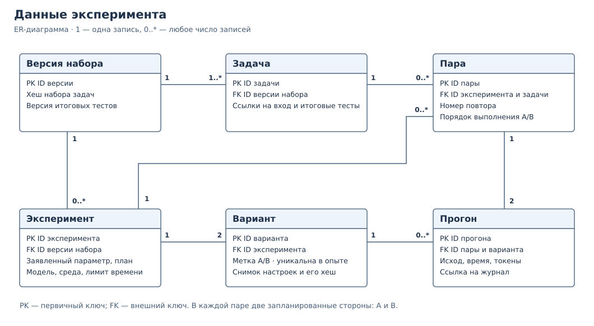
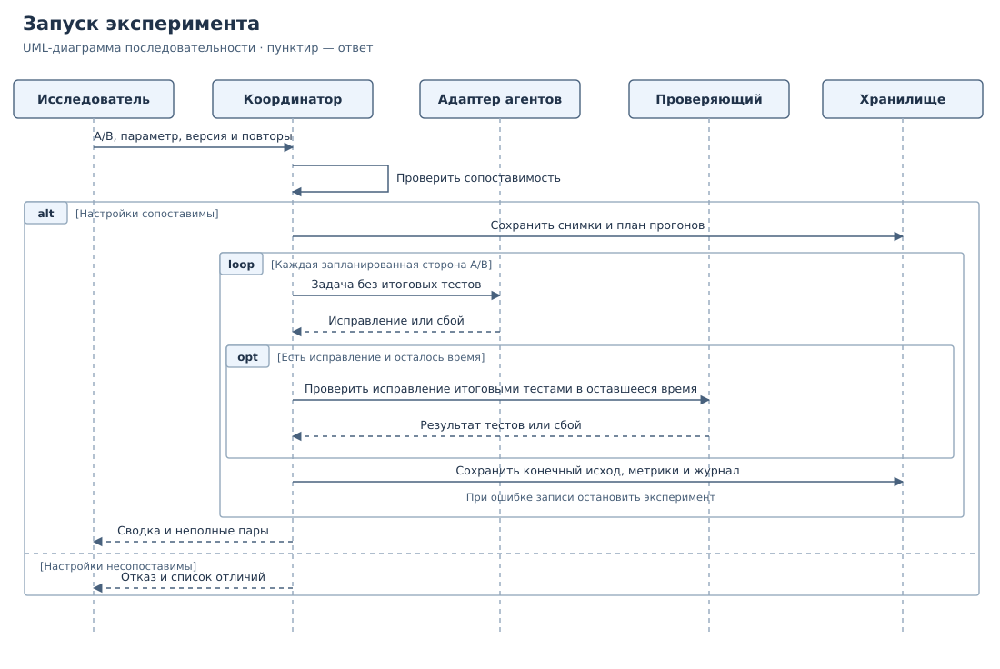
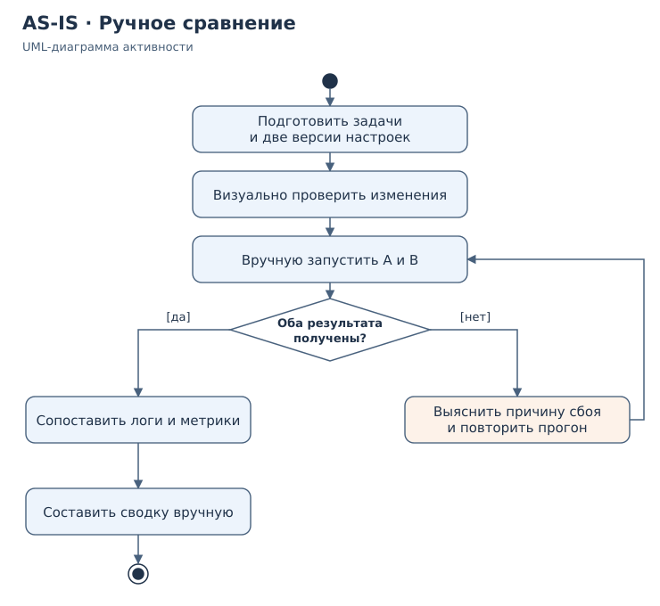
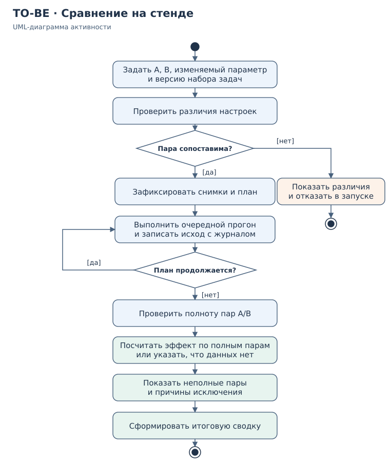

# ЛР 3 — проектирование

**Тема ВКР:** Разработка системы оценки влияния изменений конфигурации мультиагентных LLM-систем на показатели их производительности и надёжности.

**Автор:** Егор Лаптев, группа K3439.

## 1. Предметная область и требования

Стенд нужен разработчику или исследователю, который хочет понять, что изменилось после правки настроек агентной системы. Например, если поднять лимит повторных попыток с одной до двух, агенты могут решать больше задач, но тратить больше времени и токенов. Стенд запускает базовую конфигурацию A и изменённую B на одном наборе задач, проверяет результаты одинаковыми тестами и показывает разницу.

Для первого эксперимента рассматриваются небольшие задачи на исправление кода TypeScript. Агент-исполнитель предлагает исправление, агент-проверяющий оценивает его и при необходимости возвращает на доработку. Внутренние попытки агентов и экспериментальные повторы различаются: изменение лимита попыток — предмет эксперимента, а число повторов задаётся одинаковым для A и B. Итоговые тесты запускаются отдельно и недоступны агентам. На этом этапе описан проект стенда, а не результаты его реализации.

### Функциональные требования

| ID | Требование | Как проверить |
|---|---|---|
| FR-01 | Стенд принимает две конфигурации, заявленный изменяемый параметр, версию набора задач и число повторов. | Задать A и B, параметр и версию набора; передать неизвестную версию и получить понятное сообщение без запуска. |
| FR-02 | До запуска стенд сравнивает настройки и разрешает запуск только при изменении одного заявленного независимого параметра. | Для пары, где меняется только лимит попыток, построить план. Если одновременно изменена модель или конфигурации одинаковы, получить отказ и список различий. |
| FR-03 | Для каждой задачи и каждого повтора стенд запускает обе конфигурации по одному плану. | На трёх задачах с двумя повторами получить 12 записей запусков; порядок A/B в соседних парах меняется. |
| FR-04 | Стенд проверяет результат неизменным набором итоговых тестов. | Для двух заранее подготовленных исправлений получить разные статусы: «успех» и «тесты не пройдены». |
| FR-05 | Для каждого прогона стенд сохраняет исход, время, токены при наличии данных и ссылку на журнал. | Вызвать контролируемые ошибку исполнения и таймаут: они должны различаться в данных и быть видны в отчёте. |
| FR-06 | Стенд сравнивает A и B по одним и тем же задачам и выводит сводку с разбросом результатов. | На тестовых данных вручную пересчитать доли успехов, разницу по задачам и число таймаутов; сравнить с отчётом. |
| FR-07 | Стенд отмечает неполный эксперимент и не выдаёт его за полное сравнение. | Прервать запуск после завершения только A в одной из пар; в отчёте должна быть видна неполная пара, исключённая из расчёта эффекта. |

### Нефункциональные требования

| ID | Требование | Как проверить |
|---|---|---|
| NFR-01 | **Воспроизводимость условий.** До исполнения сохраняются неизменяемые снимки A/B, версия набора задач и итоговых тестов, идентификатор модели, версии среды и адаптера, порядок запусков и общий лимит времени. | По идентификатору эксперимента восстановить настройки и исходный план. При повторе условия совпадают, но ответы LLM могут различаться. |
| NFR-02 | **Прослеживаемость.** Каждое значение в сводке связано с задачей и конкретными прогонами; каждый прогон связан с вариантом A/B и журналом. | Из строки отчёта по задаче открыть записи учтённых прогонов и сверить статус и время с журналом. |
| NFR-03 | **Ограничение времени.** Для обеих конфигураций действует один и тот же лимит на прогон, включающий работу агентов и проверку. При превышении лимита стенд прекращает локальное выполнение, отмечает таймаут и переходит к следующей записи плана. | В тестовом запуске задать лимит 5 секунд и использовать исполнителя, который не отвечает. Проверить отмену, статус и продолжение очереди. |
| NFR-04 | **Устойчивость к сбоям.** Завершённые прогоны сохраняются сразу; сбой одного прогона не удаляет предыдущие результаты, а незавершённая пара явно помечается. | Остановить процесс между сторонами пары. После повторного чтения хранилища убедиться, что предыдущие результаты доступны, а незавершённая сторона не стала «успехом» или нулевым значением. |
| NFR-05 | **Изоляция итоговых тестов.** Адаптер получает только материалы задачи, предназначенные для агентов. Итоговые тесты запускаются отдельным проверяющим. | По входу адаптера и журналу проверить, что в них нет закрытых тестов; результат этих тестов появляется после завершения работы агентов. |

### Правило сравнения конфигураций

Стенд сравнивает приведённые к единой форме снимки. Порядок ключей и запись значения по умолчанию не считаются изменениями. Для пилота разрешён один параметр — лимит повторных попыток; при этом модель, роли, инструменты, инструкции, версия задачи, тесты и общий лимит времени остаются неизменными. Если при смене параметра нужно также заменить модель, инструмент или протокол взаимодействия, это сравнение двух комплексных конфигураций. Вывод о влиянии одного параметра в этом случае делать нельзя; такой эксперимент не входит в первый вариант стенда.

## 2. Обзор нотаций и видов диаграмм

| Нотация или вид диаграммы | Что показывает | Сильная сторона |
|---|---|---|
| BPMN | Процесс, события, развилки и зоны ответственности. | Удобно разделяет ручные и автоматические действия. |
| IDEF0 | Функции, их входы, выходы, управление и механизмы. | Показывает, какие ресурсы и ограничения нужны каждой функции. |
| DFD | Потоки данных между процессами, хранилищами и внешними участниками. | Помогает проверить, кто получает данные и где они сохраняются. |
| ER-диаграмма | Сущности, атрибуты, ключи и связи. | Позволяет проверить целостность данных и спроектировать схему БД. |
| UML: диаграмма вариантов использования | Пользователей системы и доступные им функции. | Помогает определить границы системы со стороны пользователя. |
| UML: диаграмма активности | Шаги процесса, условия переходов и альтернативные исходы. | Показывает, где сравнение разрешается, прерывается или продолжается после ошибки. |
| UML: диаграмма последовательности | Сообщения между участниками сценария в порядке выполнения. | Уточняет, кто выполняет проверку, где действует лимит времени и когда сохраняется результат. |
| UML: диаграмма компонентов | Компоненты системы, интерфейсы и зависимости. | Помогает отделить исполнение агентов от хранения данных и формирования отчёта. |

## 3. Выбор нотаций для проекта

| Вид | Что моделируем | Требования | Почему подходит |
|---|---|---|---|
| UML: диаграмма активности | Подготовку и проведение сравнения, ветку отказа, обработку неполной пары. | FR-01–FR-03, FR-06, FR-07 | На схеме видны условия допуска к запуску и к расчёту эффекта. Одной нотацией удобно показать AS-IS и TO-BE. |
| ER-диаграмма | Эксперимент, варианты конфигурации, версии набора задач, прогоны и журналы. | FR-01, FR-03, FR-05–FR-07; NFR-01, NFR-02, NFR-04 | По связям и ключам можно проверить, что каждый результат относится к определённым задаче, варианту и повтору. |
| UML: диаграмма последовательности | Вызовы координатора, исполнителя агентов, проверяющего и хранилища. | FR-02–FR-05; NFR-01, NFR-03–NFR-05 | Видно, когда фиксируется план, что передаётся агентам, где обрабатываются таймауты и в какой момент сохраняются данные. |

## 4. Модели системы

### 4.1. Модель данных — ER-диаграмма

**Пара** определяется ключом «эксперимент, задача, номер повтора». **Прогон** — одна сторона этой пары, A или B. Ограничение уникальности по паре и стороне не позволяет создать две записи A или две записи B для одного повтора. По плану для каждой пары создаются две записи прогона; после исполнения в них фиксируются конечные исходы. Для ещё не завершившегося прогона итоговый статус не выставляется.

Задача должна принадлежать версии набора, указанной в эксперименте. Варианты A/B принадлежат тому же эксперименту, что и пара. Эти ограничения, неизменяемые снимки и привязка журнала к прогону обеспечивают сопоставимость и позволяют проверить происхождение данных. Сводка строится по сохранённым записям, отдельная сущность для неё не нужна.

### 4.2. Выполнение и запись прогонов — UML-диаграмма последовательности

Координатор проверяет различия и сохраняет план до первого вызова адаптера. Для каждого прогона он передаёт исполнителю открытую часть задачи и снимок настроек. Если исполнитель вернул исправление, координатор вызывает проверяющего с оставшимся временем и ссылкой на зафиксированную версию итоговых тестов. Если выполнение оборвалось из-за ошибки или таймаута, проверяющий не вызывается либо прерывается по общему лимиту. Координатор сохраняет статус и журнал до перехода к следующему прогону. Если не удаётся записать результат, он останавливает эксперимент вместо продолжения без сохранения данных.

### 4.3. Правила формирования сводки

- Конечные исходы прогона: успех, тесты не пройдены, таймаут, ошибка исполнения. Пара полная, если обе стороны получили конечный исход; таймаут или ошибка сами по себе не делают её неполной.
- Для каждой задачи считаются доля успехов и разница B − A по полным парам, затем разницы агрегируются по задачам с одинаковым весом. Таймауты и ошибки входят в знаменатель. Неполные пары показываются отдельно с причинами исключения; если полных пар нет, оценка эффекта не выводится.
- Отдельно показываются медиана и 95-й перцентиль времени для прогонов, дошедших до результата тестов, вместе с числом таких прогонов и долей таймаутов и ошибок. При малой выборке перцентиль трактуется как описательная метрика пилота. Неизвестный расход токенов не заменяется нулём: отчёт показывает покрытие замеров.
- Для пилота предлагаются шесть небольших задач и два повтора пары на каждой: 24 прогона. До запуска фиксируются версии набора и среды, конкретная модель и бюджет. Число повторов основного эксперимента выбирается после пилота по наблюдаемому разбросу и доступному бюджету; 24 прогона — план, а не полученные результаты.

## 5. AS-IS и TO-BE

**Нотация:** UML-диаграмма активности. AS-IS ниже — типовой ручной сценарий, взятый для сравнения; он не описывает уже внедрённый процесс команды.

### AS-IS — ручное сравнение

Разработчик копирует настройки, запускает две версии и вручную сопоставляет логи. Если проверка конфигураций выполняется только визуально, легко пропустить дополнительное изменение. При сбое может остаться результат только одной стороны; его нельзя использовать для оценки эффекта без парного прогона.

### TO-BE — сравнение на стенде

Стенд проверяет заявленное изменение до запуска, фиксирует план и сохраняет результаты по каждой стороне пары. При несопоставимых настройках он показывает различия и не запускает эксперимент. После исполнения полные пары используются для расчёта эффекта, а неполные показываются отдельно.

| Проблема ручного сценария | Проектное решение | Где это видно |
|---|---|---|
| Случайно изменился ещё один параметр. | Автоматическая проверка снимков до запуска. | Развилка «Пара сопоставима?» в TO-BE. |
| Результаты двух версий трудно сопоставить. | Обе стороны имеют общий ключ пары; в плане одинаковые задачи и повторы. | Действие «Зафиксировать снимки и план» в TO-BE, связь «Пара — Прогон» в ER-модели. |
| Ошибка или остановка скрывает часть результатов. | Сохранение после каждого прогона, отдельный учёт неполных пар. | Действия записи и проверки полноты в TO-BE; запись результата в диаграмме последовательности. |

## 6. Выводы

Диаграммы активности описывают переход от ручного сравнения к проверяемому процессу. ER-модель задаёт, как результаты связываются с задачами, повторами и конфигурациями. Диаграмма последовательности показывает, как координатор, исполнитель и проверяющий используют эти связи, соблюдают лимит времени и записывают исходы. Вместе модели показывают, как предотвратить запуск несопоставимых конфигураций, не потерять завершённые прогоны и отделить неполные данные от расчёта эффекта. Проверка реализации и оценка разброса остаются задачами пилота.
